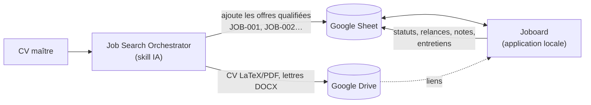

<div align="center">

<picture>
  <source media="(prefers-color-scheme: dark)" srcset="web/assets/brand/joboard-horizontal-dark.svg">
  
</picture>

**Le tableau de bord local de votre recherche d’emploi, branché sur Google Sheets.**

Offres, candidatures spontanées, contacts, entreprises VIE, notes et entretiens réunis dans une interface web en français.


</div>

---

## Sommaire

- [Pourquoi Joboard ?](#pourquoi-joboard-)
- [Joboard et le skill Job Search Orchestrator](#joboard-et-le-skill-job-search-orchestrator)
- [Fonctionnalités](#fonctionnalités)
- [Démarrage rapide](#démarrage-rapide)
- [Configuration](#configuration)
- [Structure du classeur](#structure-du-classeur)
- [Calendrier et Outlook](#calendrier-et-outlook)
- [Travailler avec votre IA](#travailler-avec-votre-ia)
- [Exécutable Windows](#exécutable-windows)
- [Architecture du projet](#architecture-du-projet)
- [Tests](#tests)
- [Confidentialité et sécurité](#confidentialité-et-sécurité)

---

## Pourquoi Joboard ?

Un Google Sheet est un excellent support pour suivre ses candidatures : partageable, historisé, modifiable partout. Mais au-delà de quelques dizaines de lignes, il devient difficile de voir quoi relancer, quel entretien préparer ou quelle entreprise contacter en priorité.

Joboard ajoute une interface de travail au-dessus de ce classeur, **sans le remplacer** :

- le Google Sheet reste la source de vérité ;
- l’application tourne **uniquement sur votre machine** (`127.0.0.1`) ;
- aucun email, message ou requête IA n’est envoyé automatiquement.

## Joboard et le skill Job Search Orchestrator

Joboard est la moitié « pilotage » d’un duo. L’autre moitié est **Job Search Orchestrator**, un skill conversationnel pour assistant IA (Claude, ChatGPT, Codex) qui automatise la partie amont de la recherche.



| | Job Search Orchestrator (skill) | Joboard (cette application) |
| --- | --- | --- |
| **Rôle** | Trouver, qualifier et préparer | Suivre, organiser et relancer |
| **Interface** | Commandes dans le chat : `/recherche`, `/offre`, `/cv`, `/lettre`, `/entretien`… | Interface web locale : tableaux, Kanban, calendrier |
| **Écrit dans le Sheet** | Nouvelles offres avec score de correspondance, résumé, liens vers CV et lettre | Statuts, dates, relances, prochaines actions |
| **Produit** | CV adaptés d’une page, lettres de motivation, briefs d’entretien | Vue d’ensemble, notes, événements, prompts prêts à copier |

Le skill n’intègre une offre que si sa correspondance **prouvée** avec le CV maître dépasse strictement le seuil configuré (75 % par défaut), sans prérequis bloquant. Joboard lit ensuite ces lignes : l’onglet `Offres` utilise exactement le même schéma (`Statut`, `Lien pour postuler`, `ID offre`, …, `CV PDF (Drive)`), ce qui permet aux deux outils de travailler sur le même classeur sans conversion.

Les deux outils restent indépendants : Joboard fonctionne avec un classeur rempli à la main, et le skill fonctionne sans Joboard.

## Fonctionnalités

**Suivi**
- Tableau de bord avec indicateurs, recherche globale et filtres.
- Vues tableau et **Kanban** pour les offres, candidatures spontanées, contacts et entreprises VIE.
- Modification directe du Google Sheet, gestion des statuts et des relances.

**Organisation**
- Notes locales rattachées à une candidature, un contact ou un événement.
- Calendrier local, calendrier Outlook publié (ICS) et intégration Microsoft Graph facultative.
- Palette de commandes `Ctrl+K`.

**IA**
- Bouton IA sur chaque fiche : un prompt structuré, modifiable, prêt à copier dans l’assistant de votre choix.
- Suivi de la consommation Claude et ChatGPT : quotas, réinitialisations et historique.

**Confort**
- Thèmes clair et sombre, affichage adapté aux mobiles.
- Logos d’entreprises mis en cache localement avec `tools/cache_company_logos.py` (cache non publié, initiales affichées à défaut).

**Écritures sûres** : les formules du classeur sont protégées, les doublons détectés, l’identité de chaque ligne revérifiée après un tri, et l’archivage se fait par changement de statut plutôt que par suppression.

## Démarrage rapide

Prérequis : **Python 3.10+** et un Google Sheet existant.

```powershell
git clone <url-du-depot> joboard
cd joboard
python -m venv .venv
.\.venv\Scripts\python.exe -m pip install -r requirements.txt
Copy-Item config.example.json config.json
```

1. Renseignez `sheet_id` dans `config.json` (la partie entre `/d/` et `/edit` dans l’URL du classeur).
2. Configurez l’[accès Google](#accès-google).
3. Lancez :

```powershell
.\.venv\Scripts\python.exe server.py
```

L’interface s’ouvre sur `http://localhost:8765/`. Fermez le terminal ou faites `Ctrl+C` pour arrêter l’application.

Aucune compilation Node.js n’est nécessaire : le serveur sert directement les fichiers de `web/`.

## Configuration

### `config.json`

| Option | Usage |
| --- | --- |
| `sheet_id` | Identifiant du Google Sheet (obligatoire). |
| `drive_url` | Dossier Google Drive ouvert par le bouton Drive de la barre latérale. Par défaut : « Mon Drive ». |
| `port` | Port local, `8765` par défaut. |
| `open_browser` | Ouvre automatiquement le navigateur au lancement. |
| `outlook_account` | Compte Outlook affiché dans l’interface. |
| `outlook_timezone` | Fuseau horaire, `Europe/Paris` par défaut. |
| `outlook_ics_url` | Lien ICS privé (alternative à la saisie dans l’interface). |
| `outlook_client_id` | Application Microsoft pour activer Microsoft Graph. |
| `outlook_tenant` | Tenant Microsoft, `consumers` par défaut. |

`config.json` reste local et est ignoré par Git.

> Si vous utilisez aussi le skill Job Search Orchestrator, mettez le **même** `sheet_id` dans `config.json` et dans `storage.sheet_id` de la configuration du skill, et le même dossier dans `drive_url` / `storage.drive_folder_url`.

### Accès Google

Deux modes sont possibles :

1. **OAuth de bureau** (recommandé pour un usage personnel) : dans Google Cloud, activez l’API Google Sheets, configurez l’écran de consentement et créez un client « Application de bureau ». Enregistrez son JSON sous `credentials.json` à la racine. Au premier lancement, une autorisation est demandée dans le navigateur et `token.json` est créé.
2. **Compte de service** : placez la clé dans `service_account.json` et partagez le classeur avec l’adresse du compte en tant qu’éditeur. Ce mode est prioritaire lorsque le fichier est présent.

Le compte utilisé doit pouvoir modifier le classeur.

## Structure du classeur

Joboard travaille sur un classeur existant et n’en crée pas. La première ligne de chaque onglet contient les noms de colonnes ; elles sont repérées par leur nom, donc l’ordre peut varier et les colonnes manquantes sont signalées dans l’interface.

| Onglet | Contenu | Identifiant |
| --- | --- | --- |
| `Offres` | Offres d’emploi, alimentées à la main ou par le skill | `JOB-###` |
| `Spontanées` | Candidatures spontanées | `SP-###` |
| `Contacts` | Recruteurs, managers, réseau | — |
| `Entreprises VIE NY` | Entreprises ciblées pour un VIE | — |
| `Statuts` *(facultatif)* | Listes de statuts personnalisées | — |
| `Tableau de bord` *(facultatif)* | Indicateurs complémentaires | — |

Le schéma complet (colonnes, champs requis, règles de doublons, statuts par défaut) est défini dans `TABS` dans [sheets.py](sheets.py).

## Calendrier et Outlook

Trois niveaux d’intégration :

- **Local** (par défaut) : les événements sont enregistrés sur le PC.
- **ICS** : collez le lien ICS publié depuis les paramètres de partage d’Outlook dans l’onglet Calendrier. Les événements Outlook s’affichent ; la création ouvre un événement prérempli à enregistrer dans Outlook. Ce lien donne accès à votre calendrier : gardez-le privé.
- **Microsoft Graph** : lecture et écriture directes. Nécessite une application Microsoft configurée pour l’authentification publique par code d’appareil, avec les permissions déléguées `User.Read`, `Calendars.ReadWrite` et `offline_access`.

## Travailler avec votre IA

Joboard ne parle à aucune IA à votre place : il **prépare le contexte**.

- L’icône IA d’une fiche ouvre un dialogue avec un prompt adapté (offre, candidature spontanée, contact ou entreprise) : mission, contexte, réponse attendue et consignes. Relisez-le, modifiez-le, puis **Copier le prompt**.
- Dans le calendrier, **Préparer pour mon IA** inclut les détails de l’événement et ses notes.
- `Ctrl+K` → **Préparer mon suivi pour mon IA** résume tout le suivi et demande un plan d’action.

Avec le skill installé dans votre assistant, vous pouvez enchaîner directement : copier le contexte d’une offre depuis Joboard, puis lancer `/entretien JOB-012` ou `/question JOB-012 …` dans le chat.

La **consommation IA**, en bas de la barre latérale, mesure les comptes Claude et ChatGPT configurés sur la machine à partir des données locales des CLI Claude Code et Codex.

## Exécutable Windows

```powershell
.\.venv\Scripts\Activate.ps1
.\build.bat
```

Le script installe les dépendances de compilation, génère l’icône et produit `dist/Joboard.exe` avec PyInstaller, ressources `web/` incluses. La configuration et les identifiants doivent se trouver à côté de l’exécutable.

> ⚠️ **`dist/` est personnel** : le script peut y copier `config.json`, `credentials.json`, `service_account.json` et `token.json`. Pour distribuer l’application, préparez un dossier séparé contenant seulement l’exécutable et `config.example.json`.

## Architecture du projet

```
├── server.py            Serveur HTTP local, configuration, authentification Google
├── sheets.py            Accès au classeur, schéma des onglets, règles d’écriture
├── organizer.py         Notes et événements locaux
├── calendar_ics.py      Lecture ICS et intégration Outlook / Microsoft Graph
├── usage.py             Consommation et quotas Claude / ChatGPT
├── web/                 Interface (HTML, CSS, JS) et ressources graphiques
├── tests/               Tests unitaires et contrôles navigateur (données fictives)
├── tools/               Utilitaires (cache des logos d’entreprises)
├── build.bat            Compilation de l’exécutable Windows
└── config.example.json  Modèle de configuration
```

Les données locales sont stockées dans `joboard-donnees/` (notes, paramètres Outlook) et `assistant-ia/` (consommation). Conservez ces dossiers lors des mises à jour.

## Tests

```powershell
python -m unittest discover -s tests -v
```

Contrôles de l’interface dans Chromium (boutons de copie, calendrier, consommation, navigation) :

```powershell
python -m pip install playwright
python -m playwright install chromium
python tests/check_copy_ui.py
```

Ces tests utilisent des données simulées et ne modifient jamais le Google Sheet.

## Confidentialité et sécurité

- Le serveur n’écoute que sur `127.0.0.1` : l’interface n’est pas accessible depuis le réseau.
- Configuration, identifiants, jetons et données locales sont exclus par le [.gitignore](.gitignore).
- Avant un commit, vérifiez `git status --short` et `git diff --cached`. Une règle d’exclusion ne retire pas un fichier déjà suivi ; si un secret a été publié, révoquez-le puis nettoyez l’historique.

## Crédits

Les attributions des logos tiers sont listées dans [web/assets/SOURCES.md](web/assets/SOURCES.md). Les marques citées appartiennent à leurs propriétaires respectifs.

Aucune licence n’est fournie pour le moment : le code est consultable, mais tous droits restent réservés à son auteur.